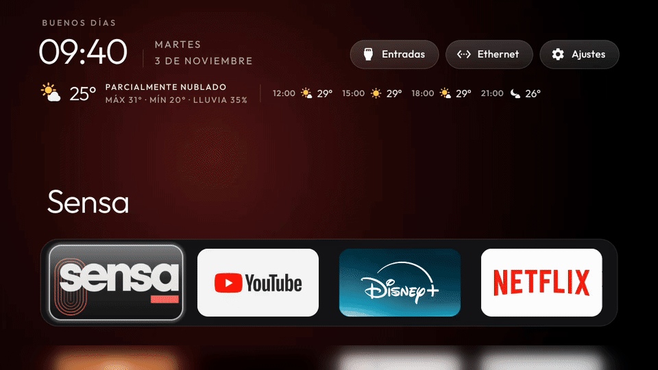

# ZenTV

**Un launcher tranquilo para Android TV y Google TV. Lo instala tu agente de IA.**

<p align="center">
  
</p>

<p align="center">
  <a href="https://github.com/hernanzini/zentv/actions/workflows/ci.yml"></a>
  <a href="../LICENSE"></a>
</p>

<p align="center"><a href="README.md">English</a> | Español</p>

ZenTV es un fork de [cleanyourtv](https://github.com/Gathin23/cleanyourtv), de Gathin y sus colaboradores. Conserva
sus listas de debloat para cientos de televisores, sus herramientas y su launcher liviano. Suma funciones
opcionales que el proyecto original deja afuera a propósito. Esas funciones usan la red o un servicio en segundo
plano.

El [README del proyecto original](../README.md) sigue vigente. Cubre los televisores soportados, el prompt, las
herramientas y la configuración del launcher. Está en inglés.

## Qué agrega ZenTV

- **El clima bajo el reloj.** La temperatura actual, la máxima y la mínima, la probabilidad de lluvia y las
  próximas horas. Indica tu ciudad por nombre.
- **La foto del día.** La foto diaria de Bing es el fondo. Se oscurece para que el texto se lea.
- **TV en vivo al encender.** El televisor arranca directo en tu app de TV en vivo, como Sensa o un reproductor
  IPTV.
  - Home espera la red primero: hasta 5 minutos después de un corte de luz, mientras arranca el router.
  - Un deep link abre la guía de la app.
  - El último canal se reproduce. Un servicio de accesibilidad envía los links de la app, una pantalla por vez.
  - Después del modo de espera, la app vuelve donde estaba.
  - Después de un corte de luz, un televisor apagado sigue apagado. Una box que arranca sola vuelve al modo de
    espera.
- **Sobrevive a las actualizaciones del launcher.** Algunos televisores apagan el servicio después de una
  actualización. Home lo vuelve a encender.

Cada función está apagada hasta que la enciendes. Sin cuentas, sin analíticas, sin publicidad.

| Función | Claves | Red |
|---|---|---|
| Clima | `weather`, `weather_city` | [Open-Meteo](https://open-meteo.com), sin cuenta ni clave, cada 30 minutos con Home en pantalla |
| Foto del día | `daily_wallpaper` | `www.bing.com`, 1 vez por día con Home en pantalla |
| TV en vivo al encender | `autostart_app`, `autostart_uri`, `autostart_steps`, `restore_standby` | Ninguna |
| Servicio activo tras actualizar | `restore_key_services` (del proyecto original) | Ninguna |

Detalles y notas de privacidad, en inglés: [docs/zentv/CONFIG.md](../docs/zentv/CONFIG.md).

## Probado en

| Televisor | Sistema | Red |
|---|---|---|
| RCA Android TV, fabricado por TCL (UnionTV) | Android TV 9 | Ethernet |
| Xiaomi TV Box S, 3.ª generación | Google TV 14 | Wi-Fi |

Los 2 reproducen el último canal cerca de 1 minuto después de un arranque en frío. Las listas de debloat cubren muchos más
televisores: mira el [README del proyecto original](../README.md).

## Instálalo con un agente de IA

Clona el repositorio y ábrelo en Claude Code, Codex, Gemini CLI o Cursor. Después pide con tus palabras:

> Limpia mi televisor en 192.168.1.50 e instala el launcher de ZenTV. Enciende el clima de mi ciudad y la foto
> del día. Abre mi app de TV en vivo al encender el televisor.

El agente sigue [PROMPT.md](../PROMPT.md) para la parte segura: backup primero, desactivar y nunca desinstalar,
nada que el televisor necesite. Sigue [docs/zentv/AGENTS.md](../docs/zentv/AGENTS.md) para las funciones de
ZenTV. Pregunta antes de tocar algo que tu familia usa.

## Instálalo a mano

1. Activa la depuración por red en el televisor, como explica el README del proyecto original.
2. Instala JDK 17 y la plataforma 34 del Android SDK.
3. Compila e instala el launcher: `TV_HOST=<tv ip> launcher/build-and-install.sh`
4. Crea una carpeta con un `config.json`:

   ```json
   {
     "weather": true,
     "weather_city": "Resistencia, Chaco, Argentina",
     "daily_wallpaper": true,
     "autostart_app": "ar.com.sensa.player",
     "autostart_uri": "minerva://content/livetv"
   }
   ```

5. Envíala al televisor: `TV_HOST=<tv ip> tools/theme.sh <folder>`
6. Opcional: para reproducir el último canal tras un arranque, agrega `autostart_steps` y enciende el servicio de
   accesibilidad. [CONFIG.md](../docs/zentv/CONFIG.md#steps-after-a-boot) tiene los pasos para Sensa.

Guarda las carpetas de tus televisores en `mytvs/`. Git la ignora.

## Cómo se mantiene al día

- Cada semana, un workflow integra el `main` del proyecto original en un pull request. CI lo prueba antes del
  merge.
- El código propio de ZenTV vive en archivos `Zen*` y `zen_*`.
- Los archivos del proyecto original llevan pocas líneas marcadas `ZenTV:`. Así cada merge es chico.
- Los arreglos que cumplen las reglas del proyecto original vuelven a él como pull requests.

## Licencia

MIT, como el proyecto original: Copyright (c) 2026 Gathin por cleanyourtv, y (c) 2026 Hernán Zini por los cambios
de ZenTV. La tipografía Outfit usa la SIL Open Font License 1.1
([launcher/FONT-LICENSE-OFL.txt](../launcher/FONT-LICENSE-OFL.txt)). Texto completo: [LICENSE](../LICENSE).
