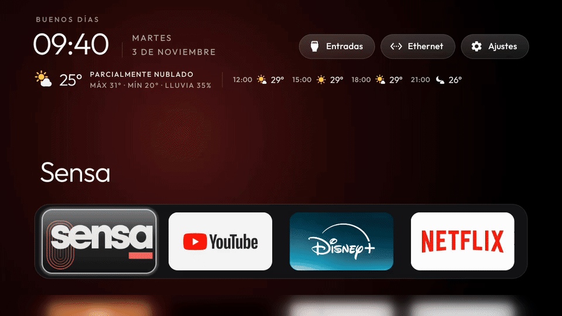

# ZenTV

**A calm launcher for Android TV and Google TV. Your AI agent sets it up.**

<p align="center">
  
</p>

<p align="center">
  <a href="https://github.com/hernanzini/zentv/actions/workflows/ci.yml"></a>
  <a href="../LICENSE"></a>
</p>

<p align="center">English | <a href="README.es.md">Español</a></p>

ZenTV is a fork of [cleanyourtv](https://github.com/Gathin23/cleanyourtv) by Gathin and its contributors. It keeps
upstream's debloat lists for hundreds of TVs, its tools and its small launcher. It adds opt-in features that
upstream leaves out on purpose, because they use the network or a background service.

Upstream's [README](../README.md) still applies: supported TVs, the prompt, the tools and the launcher's settings.

## What ZenTV adds

- **Weather under the clock.** The temperature now, today's high and low, the chance of rain and the next hours.
  Give your city by name.
- **A picture of the day.** Bing's daily photo is the wallpaper, darkened so the text stays readable.
- **Live TV at power-on.** The TV comes on straight into your live-TV app, such as Sensa or an IPTV player.
  - Home waits for the network first: up to 5 minutes after a power cut, while the router starts again.
  - A deep link opens the app's guide.
  - The last channel plays. A small accessibility service sends the app's own links, one screen at a time.
  - After standby, the app comes back where it was.
- **It survives launcher updates.** Some TVs turn the service off after an update. Home turns it back on.

Every feature is off until you turn it on. No accounts, no analytics, no ads.

| Feature | Settings | Network |
|---|---|---|
| Weather | `weather`, `weather_city` | [Open-Meteo](https://open-meteo.com), no account or key, every 30 minutes while Home is on screen |
| Picture of the day | `daily_wallpaper` | `www.bing.com`, once a day while Home is on screen |
| Live TV at power-on | `autostart_app`, `autostart_uri`, `autostart_steps` | None |
| Service back after updates | `restore_key_services` (upstream's) | None |

Details and privacy notes: [docs/zentv/CONFIG.md](../docs/zentv/CONFIG.md).

## Tested on

| TV | System | Network |
|---|---|---|
| RCA Android TV, built by TCL (UnionTV) | Android TV 9 | Ethernet |
| Xiaomi TV Box S, 3rd gen | Google TV 14 | Wi-Fi |

Both TVs play the last channel about 1 minute after a cold boot. The debloat lists cover many more TVs: see
upstream's [README](../README.md).

## Set it up with an AI agent

Clone the repository and open it in Claude Code, Codex, Gemini CLI or Cursor. Then ask in your own words:

> Clean up my TV at 192.168.1.50 and install the ZenTV launcher. Turn on the weather for my city and the
> picture of the day. Open my live-TV app when the TV comes on.

The agent follows [PROMPT.md](../PROMPT.md) for the safe part: backups first, disable never uninstall, nothing the
TV needs. It follows [docs/zentv/AGENTS.md](../docs/zentv/AGENTS.md) for ZenTV's features. It asks before it
touches anything your family uses.

## Set it up by hand

1. Enable network debugging on the TV, as upstream's README explains.
2. Install JDK 17 and the Android SDK platform 34.
3. Build and install the launcher: `TV_HOST=<tv ip> launcher/build-and-install.sh`
4. Create a folder with a `config.json`:

   ```json
   {
     "weather": true,
     "weather_city": "Resistencia, Chaco, Argentina",
     "daily_wallpaper": true,
     "autostart_app": "ar.com.sensa.player",
     "autostart_uri": "minerva://content/livetv"
   }
   ```

5. Push it: `TV_HOST=<tv ip> tools/theme.sh <folder>`
6. Optional: to play the last channel after a boot, add `autostart_steps` and turn on the accessibility service.
   [CONFIG.md](../docs/zentv/CONFIG.md#steps-after-a-boot) has the steps for Sensa.

Keep your own TVs' folders in `mytvs/`. Git ignores it.

## How ZenTV stays current

- Every week, a workflow merges upstream's `main` into a pull request. CI tests it before it lands.
- ZenTV's own code lives in files named `Zen*` and `zen_*`.
- Upstream files carry only a few lines marked `ZenTV:`, so each merge stays small.
- Fixes that fit upstream's rules go back upstream as pull requests.

## License

MIT, like upstream: Copyright (c) 2026 Gathin for cleanyourtv, and (c) 2026 Hernán Zini for ZenTV's changes. The
Outfit typeface is under the SIL Open Font License 1.1 ([launcher/FONT-LICENSE-OFL.txt](../launcher/FONT-LICENSE-OFL.txt)).
Full text: [LICENSE](../LICENSE).
